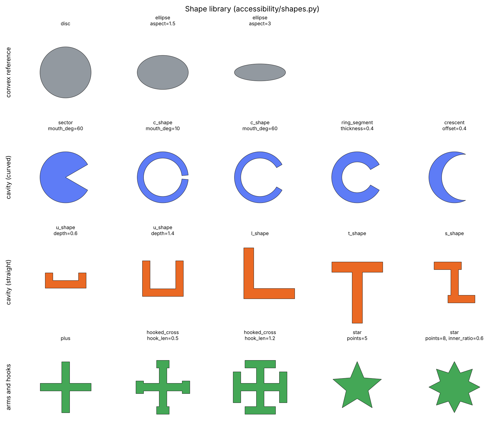
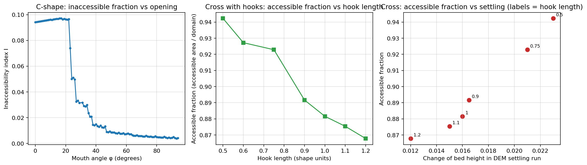
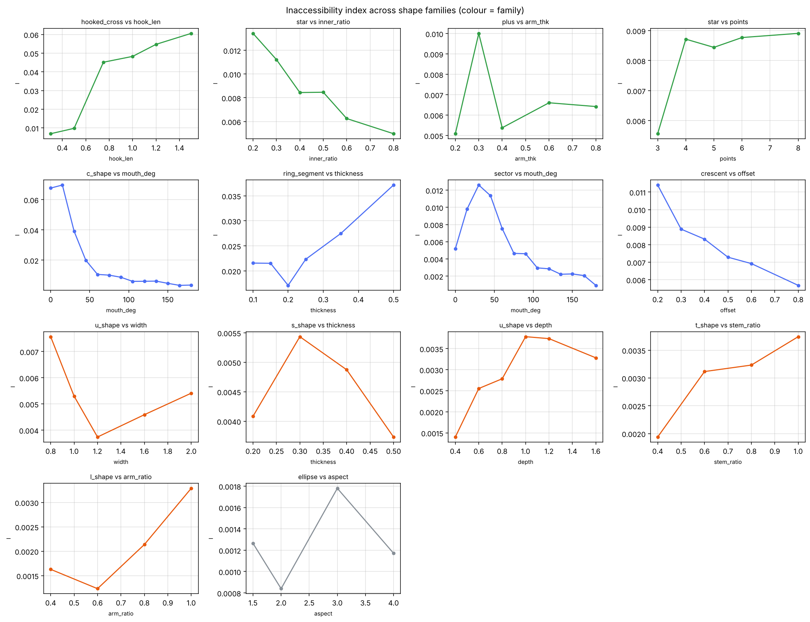
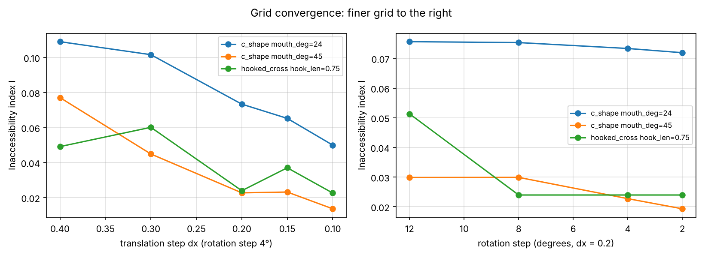

# Non-convex Particle Accessibility

How the shape of a non-convex grain decides whether neighbouring grains can reach the space around and inside it, and how that relates to how a bed of such grains settles. This started as undergraduate research on granular packing of non-convex particles (Grinnell College, Department of Mathematics, 2025), where the sweeps were run on the Grinnell College HPC cluster with MPI. The repository now also has a reusable Python package, a 13-shape library, config-driven batch sweeps and tests that reproduce the original results.



## Contents

- [Quick start](#quick-start)
- [Method](#method)
- [Shape library](#shape-library)
- [Batch sweeps](#batch-sweeps)
- [Reproducibility](#reproducibility)
- [Results](#results)
- [Repository layout](#repository-layout)
- [DEM settling with perigrain-lite](#dem-settling-with-perigrain-lite)
- [Known limitations](#known-limitations)

## Quick start

```bash
pip install -e ".[test]"         # add ".[mpi]" for MPI runs
make test                         # fast tests, a few seconds
make reproduce                    # recompute the original C-shape and cross sweeps
make compare                      # sweep all 13 shapes and plot them
```

From Python:

```python
from accessibility import Grid, compute, make

shape = make("c_shape", mouth_deg=45)
result = compute(shape, Grid(domain_radius=2.5, dx=0.2, dtheta_deg=4))
print(result.inaccessibility)     # 0.0227
```

## Method

1. Fix one copy of the particle at the origin.
2. Place a second, identical copy at every point of a grid of translations (x, y) and rotations θ, and keep each placement that does not overlap the fixed copy.
3. The union of the kept placements, clipped to a circular domain, is the **accessible region**.
4. Two measures come out of it:
   - inaccessibility index `I = (domain − particle − accessible) / domain`, the share of the domain no second particle can reach (used for the C-shape);
   - accessible fraction `accessible / domain` (the number the original cross script reported).

`accessibility/core.py` implements this with Shapely 2's vectorised geometry functions: for each rotation it builds every translated copy at once and tests all overlaps in one call. On the same grid the original loop took minutes per parameter value; this takes about 6 seconds for a C-shape and gives identical numbers (see [Reproducibility](#reproducibility)).


*Blue: fixed C-shape (φ = 24°). Green: area a second C-shape can reach. White: unreachable area.*

## Shape library

`accessibility/shapes.py` has 13 shapes in four families. Every builder takes keyword parameters, which is what the sweeps vary.

| Family | Shapes | Main parameters |
|---|---|---|
| Convex reference | `disc`, `ellipse` | `radius`, `aspect` |
| Cavity (curved) | `sector` (Pac-Man), `c_shape`, `ring_segment`, `crescent` | `mouth_deg`, `inner_radius`, `thickness`, `offset` |
| Cavity (straight) | `u_shape`, `l_shape`, `t_shape`, `s_shape` | `depth`, `width`, `arm_ratio`, `stem_ratio`, `thickness` |
| Arms and hooks | `plus`, `hooked_cross`, `star` | `arm_thk`, `hook_len`, `points`, `inner_ratio` |

`sector`, `c_shape` and `hooked_cross` are the shapes from the original research; the rest were added to compare families. Convex shapes have no cavity, so whatever `I` they show is the grid's resolution limit (see limitations).

## Batch sweeps

A sweep is a JSON config: a grid and a list of (shape, parameter, values):

```json
{
  "name": "c_shape_mouth",
  "grid": {"domain_radius": 2.5, "dx": 0.2, "dtheta_deg": 4},
  "sweeps": [
    {"shape": "c_shape", "vary": "mouth_deg", "values": {"start": 0, "stop": 95, "step": 5}}
  ]
}
```

```bash
python -m accessibility.sweep configs/all_shapes.json --workers 4            # local process pool
mpirun -n 16 python -m accessibility.sweep configs/all_shapes.json --mpi     # MPI ranks
python -m accessibility.sweep configs/all_shapes.json --frames frames/       # also save one PNG per job
python -m accessibility.sweep configs/all_shapes.json --dry-run              # list the jobs
```

- Each (shape, value) is an independent job, so they are split across worker processes or MPI ranks with no communication until the end.
- Results go to `results/<name>.csv`, one row per job, including the grid used and the run time. Rows are written as jobs finish.
- Re-running a config skips jobs already in the CSV, so an interrupted or timed-out cluster job resumes where it stopped.
- `hpc/sweep_pbs.sh` and `hpc/sweep_slurm.sh` are job scripts for PBS and Slurm clusters.

| Config | Jobs | What it runs |
|---|---|---|
| `configs/reproduce_c_shape.json` | 19 | Original C-shape sweep settings |
| `configs/reproduce_cross.json` | 7 | Original hooked-cross sweep settings |
| `configs/all_shapes.json` | 88 | One or two parameter sweeps for every shape family |
| `configs/smoke_test.json` | 3 | Coarse grid, runs in about a second |

## Reproducibility

The refactored code was checked against outputs saved by the original research scripts. These checks are in `tests/test_accessibility.py` (marked `slow`) and run with `make test-all`.

| Original output | Saved value | Refactored code |
|---|---|---|
| C-shape, φ = 24° (figure title) | I = 0.0733 | 0.0733 |
| C-shape, φ = 45° (figure title) | I = 0.0227 | 0.0227 |
| Hooked cross, 7 hook lengths from 0.5 to 1.2 | accessible fraction 0.94228 … 0.86779 | identical to 5 decimals for all 7 |

The other tests check that every shape is a valid polygon, that the area bookkeeping adds up, that a narrow C-shape opening is less accessible than a wide one, and that a batch sweep writes and resumes correctly. All 24 tests pass on Python 3.10 with Shapely 2.1 and on Python 3.13 with Shapely 2.2.

## Results

### Original research results

Numbers from the saved outputs in `results/`. Run `analysis/summary_plots.py` to regenerate the figure.



**C-shape (`results/c_shape_vs_mouth_angle.csv`, 94 mouth angles)**
- For φ up to 22°, I stays near 0.094 to 0.097: the opening is too narrow for another C-shape to enter, so the inner cavity is unreachable.
- Between φ = 22° and 23°, I drops from about 0.096 to 0.074. It then falls in steps to about 0.03 by φ = 27° and about 0.014 by φ = 38°, and slowly to about 0.004 at φ = 94°.

**Hooked cross (`results/cross_hook_accessibility.csv`, 7 hook lengths)**
- The accessible fraction falls as the hooks get longer: 0.942 at hook length 0.5, 0.923 at 0.75, 0.882 at 1.0 and 0.868 at 1.2.

**Link to settling (6 DEM runs on the cluster)**
- The more accessible the cross, the more the bed settled. Bed-height change goes from 0.012 at hook length 1.2 to 0.023 at hook length 0.5.
- The two measures have the same ordering in all six runs (Spearman rank correlation 1.0). `analysis/fit_accessibility_vs_height_change.py` fits a logistic curve.
- Six points, one run per shape, is a small sample, so this is a trend, not a fitted law.

| Initial arrangement (Pac-Man, perigrain) | During settling | Settled bed, cross with hook length 0.75 |
|---|---|---|
|  |  |  |

A video of the C-shape sweep frames is in `figures/phi_sweep_demo.mp4`.

### All shape families

`configs/all_shapes.json` (domain radius 3, dx 0.2, 6° rotations, 88 jobs). Summary table: `results/all_shapes_summary.csv`.



- On this grid even a convex disc gets I = 0.005, which is the grid's resolution limit, not a real cavity.
- Only three families rise clearly above that:
  - the **C-shape** (I up to 0.070 for a narrow opening);
  - the **hooked cross** (up to 0.061 for long hooks);
  - the **ring segment** (0.017 to 0.037, rising with wall thickness at a 40° gap).
- The open straight-walled shapes (U, L, T, S) and the star stay at 0.001 to 0.013, about the level of the disc. On this grid, their differences should not be read as real.

### Grid convergence

`analysis/grid_convergence.py` recomputes I while refining the translation step and the rotation step separately.



- **Rotation step** matters little once it is 4° or finer. The hooked cross gives identical values at 8°, 4° and 2°, as expected for a shape with 90° symmetry.
- **Translation step** matters a lot. For the C-shape at φ = 24°, I goes from 0.073 at dx = 0.2 (the original setting) to 0.050 at dx = 0.1.
- So the absolute values of I depend on the grid. Comparisons between shapes on the **same** grid (the trends above) are the meaningful output. A finer grid, or an exact configuration-space method, would be the next step.

## Repository layout

| Path | Contents |
|---|---|
| `accessibility/` | Package: `shapes.py` (shape library), `core.py` (accessibility calculation), `sweep.py` (batch runner), `plotting.py` |
| `configs/` | JSON sweep configs |
| `tests/` | pytest suite, including the reproduction checks |
| `hpc/` | PBS and Slurm job scripts for MPI sweeps |
| `results/` | All results as CSV |
| `analysis/` | Summary, shape-comparison, convergence, escape-direction and logistic-fit scripts |
| `shapes/shape_gallery.py` | Draws the shape library |
| `c_shape/`, `cross_shape/` | The original research scripts (serial and MPI sweeps, video rendering), kept as they were run |
| `dem_settling/` | Hooked-cross shape for perigrain and the HPC frame-sync and video scripts |
| `mesh/generate_gmsh_geo.py` | Writes a Gmsh `.geo` file with the fixed and trial particles |
| `figures/` | Figures used in this README |

## DEM settling with perigrain-lite

The settling runs used perigrain-lite, the research group's peridynamics/DEM code by Debdeep Bhattacharya. Its repository is private, so it is not included here. My work in it (branch `annulus-bulk-setup`, plus later local changes):

- Turned a 3D sphere-collision example into a 2D bulk-settling setup: 36 particles on a 6×6 grid with random initial rotations, first with annulus particles and then with hooked crosses.
- Added the hooked-cross shapes to the shape library (`cross_shape`, `cross_shape_v2`, meshed with pygmsh). The same functions are in `dem_settling/cross_shape_perigrain.py`.
- Set up runs of the 2D solver with `mpirun` under PBS on the cluster, and adjusted output frequency and plotting for the bulk runs.
- Got the code to build on macOS with Homebrew HDF5, and added mesh export to the mesh generator.
- Wrote the pipeline that pulls rendered frames from the cluster with rsync and turns them into videos (`dem_settling/`).

## Known limitations

- Absolute values of I depend on the translation grid; see [Grid convergence](#grid-convergence).
- The C-shape and the cross use different domain radii (2.5 and 3), so their index values are not directly comparable.
- The saved C-shape CSV (`results/c_shape_vs_mouth_angle.csv`) was produced with earlier settings. `configs/reproduce_c_shape.json` reproduces the `inaccessibility_sweep.py` settings, which match the saved figures but not that CSV exactly.
- Bed-height changes come from the DEM runs on the cluster. The raw simulation output is not included because of its size.
- The scripts in `c_shape/` and `cross_shape/` are research iterations, kept as they were run. New work should use the `accessibility` package.

## Credits

The DEM settling runs use perigrain-lite by Debdeep Bhattacharya. This repository includes only my own scripts and shape definitions. The public [perigrain](https://github.com/debdeepbh/perigrain) code is MIT licensed.
