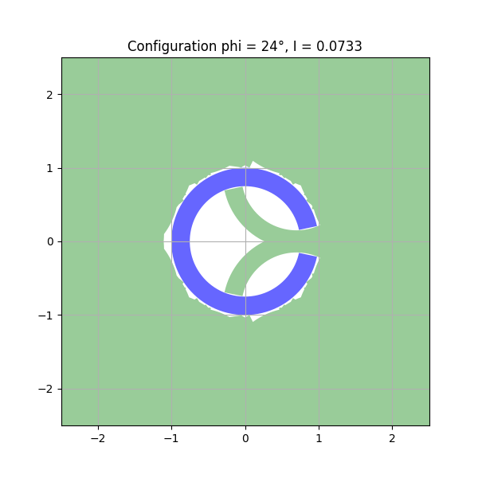
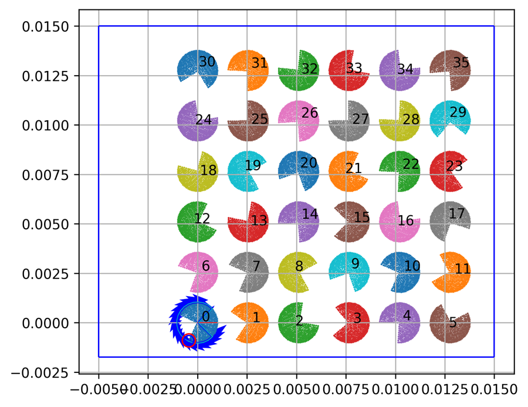
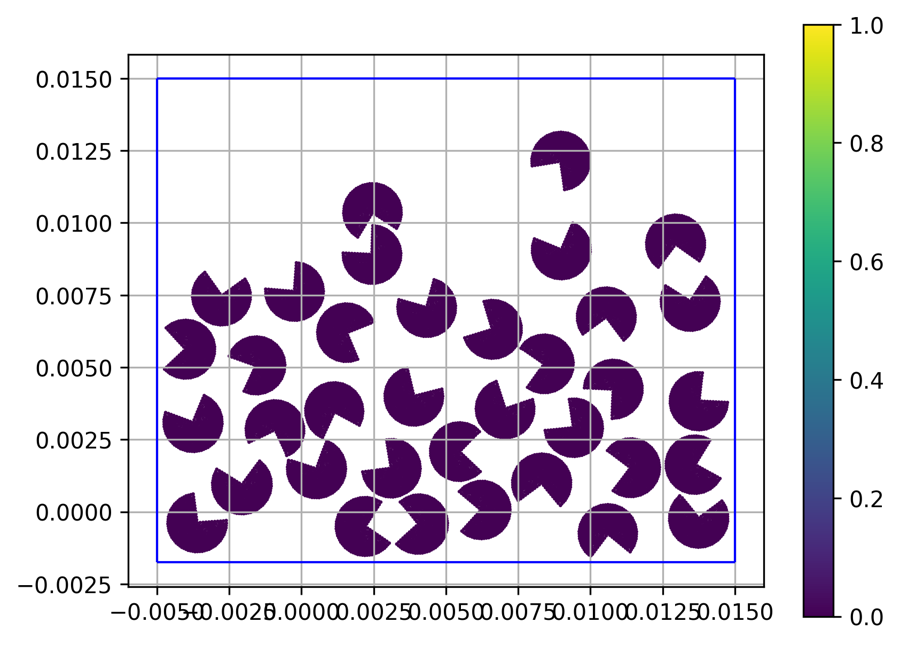
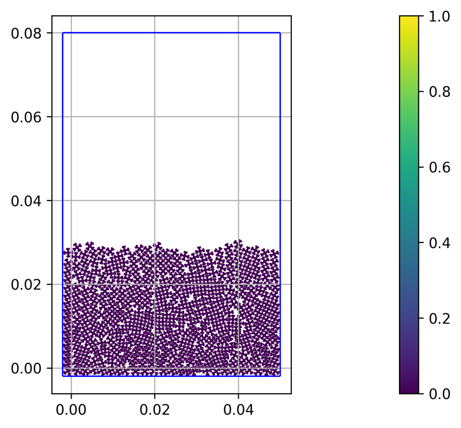

# Non-convex Particle Accessibility

How the shape of a non-convex grain decides whether neighbouring grains can reach the space around and inside it, and how that relates to how a bed of such grains settles. Written during undergraduate research on granular packing of non-convex particles (Grinnell College, Department of Mathematics, 2025). The parameter sweeps were run on the Grinnell College HPC cluster, parallelised with MPI.


## Question

When non-convex grains settle into a packing, a concave pocket can only be filled if another grain can get into it. For a given shape, what fraction of the space near a grain can a second, identical grain never reach? How does that fraction change with the shape parameter (opening angle, hook length), and does it predict how much a bed of those grains settles?

## Shape families

| Family | Definition | Parameter swept | Scripts |
|---|---|---|---|
| Pac-Man (sector) | Unit disc with a wedge removed | Mouth angle φ | `c_shape/reachable_area_v1_sector.py` |
| C-shape | Sector minus an inner disc of radius 0.75 | Mouth angle φ, 0° to 94° | `c_shape/` |
| Cross with hooks | Two crossed bars (length 1.5, thickness 0.3) with a hook across each arm end | Hook length, 0.5 to 1.2 | `cross_shape/`, `dem_settling/` |

`shapes/shape_gallery.py` draws all three families (figure above).

## Method

1. Build the particle as a Shapely polygon and hold one copy fixed at the origin.
2. Sweep a second identical copy over a grid of translations (x, y) and rotations θ, and keep every placement where the two do not overlap.
3. The union of the kept placements is the accessible region. Inside a circular domain, the inaccessibility index is
   `I = (domain area − particle area − accessible area) / domain area`, and accessibility is `1 − I`.
4. Repeat for each value of the shape parameter. Each parameter value is independent, so `c_shape/inaccessibility_sweep_mpi.py` splits the values across MPI ranks (`for i in range(rank, len(phi_values), size)`) and was run with `mpirun` on the HPC cluster.
5. For the hooked cross, the same shapes were meshed and settled under gravity in the [perigrain](https://github.com/debdeepbh/perigrain-lite) peridynamics/DEM code on the cluster, and the change in bed height was recorded for each hook length.
6. A second, cheaper measure (`analysis/escape_directions.py`) casts rays from the C-shape centroid and counts the directions that leave without hitting the particle.



*Blue: fixed C-shape (φ = 24°). Green: area a second C-shape can reach. White: unreachable area.*

## Results

All numbers below come from the saved outputs in `results/`. `analysis/summary_plots.py` regenerates the figure.


**C-shape (`results/c_shape_vs_mouth_angle.csv`, 94 mouth angles).**
- For φ up to 22°, the inaccessibility index stays near 0.094 to 0.097: the opening is too narrow for another C-shape to enter, so the inner cavity is unreachable.
- Between φ = 22° and 23° it drops from about 0.096 to 0.074, then falls in steps to about 0.03 by φ = 27° and about 0.014 by φ = 38°.
- Above that it decreases slowly to about 0.004 at φ = 94°.

**Cross with hooks (`results/cross_hook_accessibility.csv`, 7 hook lengths).**
- Accessibility falls steadily as the hooks get longer: 0.942 at hook length 0.5, 0.923 at 0.75, 0.882 at 1.0 and 0.868 at 1.2.

**Link to settling (6 DEM runs).**
- Across the six hook lengths with a settling run, a more accessible shape settled more: the bed-height change goes from 0.012 at hook length 1.2 (accessibility 0.868) to 0.023 at hook length 0.5 (accessibility 0.942).
- The two measures have the same ordering in all six runs (Spearman rank correlation 1.0). `analysis/fit_accessibility_vs_height_change.py` fits a logistic curve to these points.
- Six points from one run per shape is a small sample, so this is a trend, not a fitted law.

| Initial arrangement (Pac-Man, perigrain) | During settling | Settled bed, cross with hook length 0.75 |
|---|---|---|
|  |  |  |

A frame-by-frame video of the C-shape sweep is in `figures/phi_sweep_demo.mp4`.

## Repository layout

| Path | Contents |
|---|---|
| `c_shape/` | Reachable-area prototypes, the inaccessibility sweep over φ (serial and MPI), and video rendering |
| `cross_shape/cross_hook_sweep.py` | Accessibility sweep over hook length for the hooked cross |
| `dem_settling/cross_shape_perigrain.py` | The hooked cross written as a perigrain shape (`cross_shape`, `cross_shape_v2`) for DEM settling runs |
| `dem_settling/*.sh`, `render_frames_to_video.py` | Pull rendered frames back from the cluster with rsync and stitch them into videos |
| `analysis/` | Escape directions, accessibility vs escape fraction, accessibility vs bed-height change, summary figure |
| `shapes/shape_gallery.py` | Draws every shape family |
| `mesh/generate_gmsh_geo.py` | Writes a Gmsh `.geo` file with the fixed and trial particles |
| `results/` | Saved results as CSV |
| `figures/` | Figures used in this README |

## Running

```bash
pip install -r requirements.txt

# accessibility sweeps (slow: tens of thousands of polygon placements per parameter value)
python c_shape/inaccessibility_sweep.py
mpirun -n 8 python c_shape/inaccessibility_sweep_mpi.py
python cross_shape/cross_hook_sweep.py

# figures from the saved results (fast)
python shapes/shape_gallery.py
python analysis/summary_plots.py
python analysis/fit_accessibility_vs_height_change.py
```

Run scripts from the repository root. The `dem_settling/` files need a perigrain-lite checkout and are included to document how the DEM runs were set up, not to run on their own.

## Known limitations

- Results depend on the translation grid (0.1 to 0.2 length units) and rotation step (2° to 10°). No grid-convergence study is included, so the exact location of the C-shape drop is approximate.
- The C-shape uses a domain of radius 2.5 and the cross a domain of radius 3, so their index values are not directly comparable.
- The saved C-shape CSV was produced with earlier versions of the scripts. Re-running `analysis/escape_directions.py` today gives different escape-direction counts at larger φ.
- The bed-height values come from the DEM runs on the cluster. The raw simulation output is not included because of its size.
- The scripts are research iterations, not a package, and several are overlapping variants of the same calculation.

## Credits

The DEM settling runs use [perigrain-lite](https://github.com/debdeepbh/perigrain-lite) by Debdeep Bhattacharya (MIT licence). This repository includes only my own scripts and shape definitions, not perigrain code.
