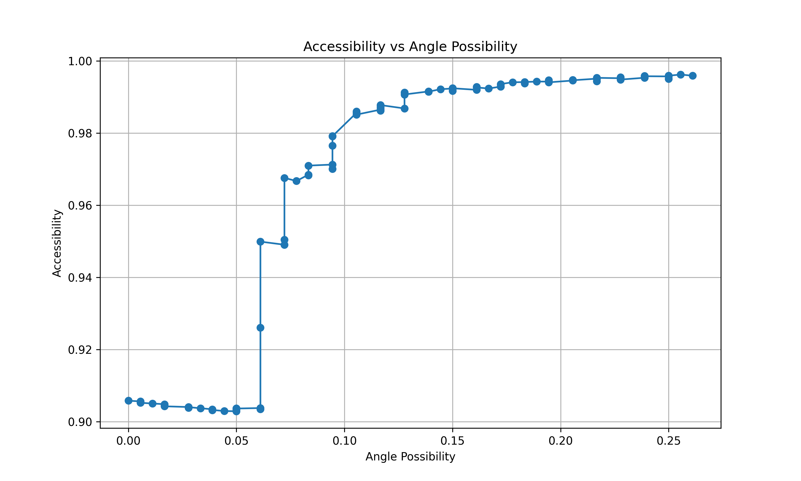

# Non-convex Particle Accessibility

2D geometric analysis of how the shape of a non-convex grain controls whether a second grain can reach the space around and inside it. Written during undergraduate research on granular packing of non-convex particles (Grinnell College, Department of Mathematics, 2025).


*Blue: fixed C-shaped particle (mouth angle 24°). Green: area that a second, identical particle can reach without overlapping it. White: area it cannot reach.*

## Question

When non-convex grains settle into a packing, a concave pocket can only be filled if another grain can actually get into it. For a C-shaped particle, how does the fraction of unreachable space change with the opening (mouth) angle φ? Does a different shape, such as a cross with hooked ends, behave similarly?

## Method

1. Build the particle as a Shapely polygon. The C-shape is a unit-radius disc sector with mouth angle φ, minus an inner disc of radius 0.75.
2. Hold one copy fixed at the origin. Sweep a second identical copy over a grid of translations (x, y) and rotations θ.
3. Keep every placement where the two polygons do not intersect. The union of the kept placements is the accessible region.
4. Compute the inaccessibility index `I = (domain area − fixed particle area − accessible area) / domain area` inside a circular domain of radius 2.5.
5. Repeat for φ from 0° to about 90°, and plot I against φ.

A second measure, in `analysis/escape_directions.py`, casts rays from the particle centroid and counts the directions that do not hit the particle.

## Repository layout

| Path | What it does |
|---|---|
| `c_shape/reachable_area_v1_sector.py` | First prototype: sector-shaped particle without the inner cutout |
| `c_shape/reachable_area_v2_c_shape.py` | C-shape (sector minus inner disc), reachable area plot |
| `c_shape/inaccessibility_index_single.py` | Inaccessibility index I for one particle in the radius-2.5 domain |
| `c_shape/inaccessibility_sweep.py` | Sweep over φ: I, one figure per φ, video of the frames, I vs φ plot |
| `c_shape/inaccessibility_sweep_mpi.py` | Same sweep, parallelised over φ with `mpi4py` |
| `c_shape/inaccessibility_sweep_unit_disk.py`, `accessibility_sweep_unit_disk.py` | Earlier sweeps on a unit-disc domain |
| `c_shape/render_video.py` | Stitch the saved frames into an mp4 with OpenCV |
| `cross_shape/cross_hook_sweep.py` | Same analysis for a cross with hooked ends, sweeping hook length |
| `analysis/escape_directions.py` | Count free escape directions from the centroid for each φ |
| `analysis/plot_accessibility_vs_escape.py` | Plot accessibility against the escape-direction fraction |
| `mesh/generate_gmsh_geo.py` | Write a Gmsh `.geo` file with the fixed and trial particles (a first step toward meshing) |
| `data/accessibility_vs_mouth_angle.csv` | Saved results: I, escape directions, accessibility for φ = 0° to 94° |

## Results (preliminary)



A frame-by-frame video of the sweep over φ is in `figures/phi_sweep_demo.mp4`.

In the saved data (`data/accessibility_vs_mouth_angle.csv`):

- At φ = 0° the inaccessibility index is about 0.094, and it stays near 0.09 to 0.10 up to φ = 20°.
- Between φ = 20° (I ≈ 0.096) and φ = 31° (I ≈ 0.032) it drops sharply. This is the jump visible in the plot above.
- Above that, I keeps decreasing slowly and is about 0.004 at φ = 94°.

No convergence study on the grid spacing is included, so the exact location of the jump is approximate.

## Running

```bash
pip install -r requirements.txt
python c_shape/inaccessibility_sweep.py          # sweep over φ, writes frames and a plot
mpirun -n 4 python c_shape/inaccessibility_sweep_mpi.py
python analysis/escape_directions.py
python cross_shape/cross_hook_sweep.py
```

Scripts write their outputs (frames, csv files) to relative folders, so run them from the repository root. `opencv-python`, `natsort` and `mpi4py` are only needed for the video and parallel scripts.

## Known limitations

- Results depend on the grid used for translations (0.1 to 0.2 length units) and rotations (2° to 10° steps). Finer grids will move the numbers slightly.
- The scripts are research iterations, not a package. Several contain overlapping variants of the same calculation, listed in the table above.
- The saved CSV was produced with earlier versions of the scripts. Re-running `analysis/escape_directions.py` today gives different escape-direction counts for larger φ, so the CSV is not an exact reproduction of the current code.
- `accessibility_sweep_unit_disk.py` reports accessible area under the name `I`, while the other scripts define I as the inaccessible fraction.
- The Gmsh script only writes a `.geo` geometry file. Meshing and the 3D simulations are not part of this repository.

## Related work

For the 3D peridynamics and DEM side of this line of work, see the open-source [perigrain](https://github.com/debdeepbh/perigrain) code by Debdeep Bhattacharya (MIT licence). This repository contains only the 2D scripts above and does not include any perigrain code.
